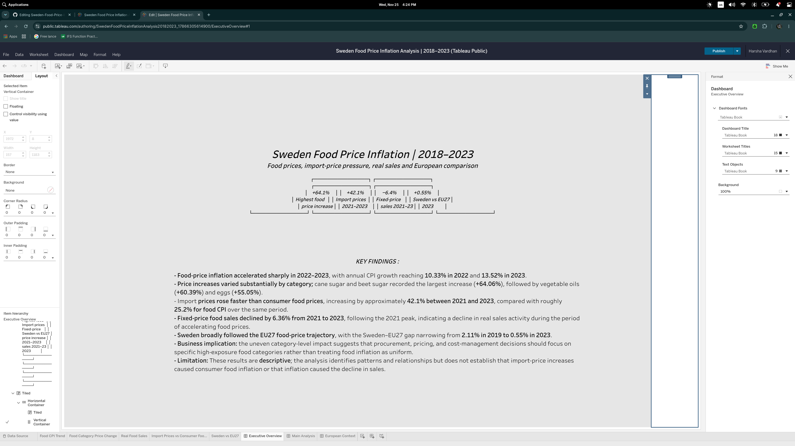
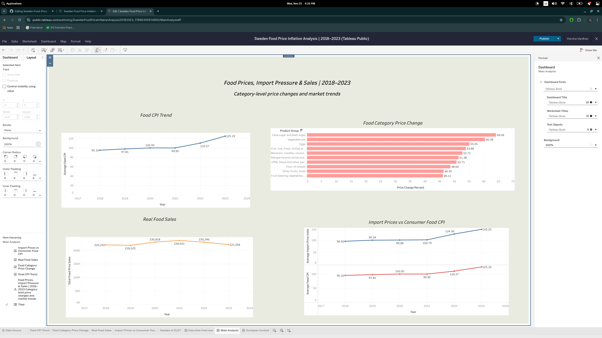
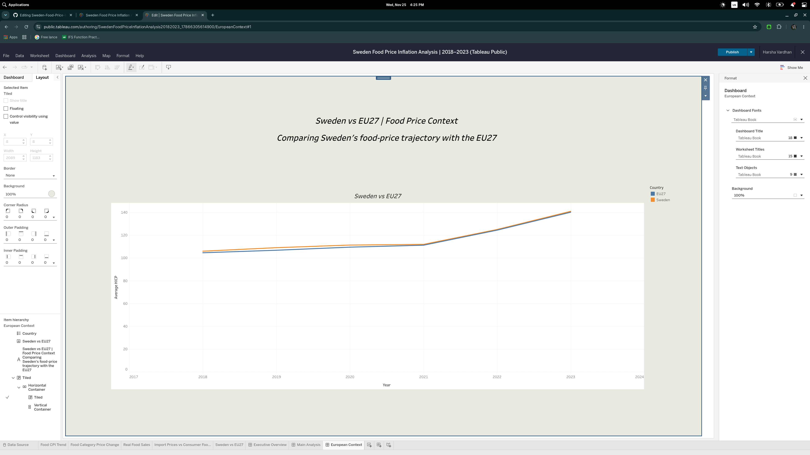

# Sweden Food Price Inflation: Supply Chain Cost Transmission Analysis (2018–2023)

Swedish food prices rose 25.2% between 2021 and 2023 while upstream import prices rose 42.1% across the same period. This project investigates where cost pressure was concentrated, how it moved through the supply chain, and what it meant for real food sales volumes across 58 categories using four official Swedish and European government datasets.

> **This is Part 1 of a two-part Swedish market analysis.** Part 2 covers consumer demand recovery and six-month forward volume forecasting by retail category: [Swedish Retail Demand Recovery (2015–2026)](INSERT_GITHUB_LINK_HERE)

---

## Dashboard

[View on Tableau Public](https://public.tableau.com/views/SwedenFoodPriceInflationAnalysis20182023_17866305614900/ExecutiveOverview)

## Dashboard preview

**Page 1 -- Risk Overview**  


**Page 2 -- Supply Concentration**  


**Page 3 -- Price Risk and Conclusions**  


---

## Business Problem

Sweden's 2022–2023 food price shock raised a supply chain question worth investigating properly. Not just what rose, but where cost pressure was concentrated, how upstream import prices related to consumer prices, and whether real demand actually changed.

The overall food CPI tells you prices increased. It does not tell you where the pressure came from, which categories were most exposed, or whether consumers actually bought less.

This project moves from the headline number to the supply chain reality underneath it.

---

## Key Findings

**Cost pressure was not uniform across the market.** The spread between the highest and lowest category inflation over 2018 to 2023 was more than 50 percentage points.

| Category | Increase |
|---|---|
| Cane sugar and beet sugar | +64.06% |
| Vegetable oils | +60.39% |
| Eggs | +55.05% |
| Fish | +53.86% |
| Pasta | +52.71% |

The lowest category increase across all 58 was +11.27%.

**Upstream import prices moved significantly faster than consumer food prices.**

| Indicator | 2021 | 2023 | Change |
|---|---|---|---|
| Import Price Index | 100.79 | 143.23 | +42.1% |
| Food CPI | 99.95 | 125.19 | +25.2% |

This gap indicates substantial upstream cost pressure that was not fully passed through to consumers.

**Real food sales declined despite rising nominal turnover.**

| Year | Fixed-Price Sales (SEK M) |
|---|---|
| 2021 | 236,631 |
| 2022 | 230,246 |
| 2023 | 221,594 |

A 6.36% volume decline from 2021 to 2023. Consumers were spending more while buying less.

**Sweden tracked EU27 closely.** The Sweden to EU27 food price gap narrowed from +2.11% in 2019 to +0.55% in 2023, confirming this was a broad European supply chain shock rather than a Sweden-specific event.

---

## Business Implications

**For procurement teams:** Category-level cost monitoring identifies where input price exposure is actually concentrated, not just where the average points.

**For demand planning teams:** Nominal sales growth masked a real volume decline. Separating price effects from volume effects is essential for accurate demand signals.

**For supplier negotiation:** Upstream import prices moved significantly faster than consumer prices, creating a cost absorption window that procurement teams needed to manage actively.

**For cross-market planning:** Sweden's close tracking of EU27 suggests that businesses operating across European markets faced structurally similar cost environments during this period.

---

## Methodology

**Phase 1: Data cleaning in Python.** Four official government datasets sourced, cleaned, and validated in Google Colab using pandas. Key steps included data type conversion, date standardisation, missing value checks, and cross-dataset validation.

**Phase 2: Database preparation in MySQL.** Cleaned datasets loaded into MySQL via DBeaver creating a structured analytical environment across all four sources.

**Phase 3: SQL analysis.** Year-over-year calculations, category-level aggregations, import vs consumer price comparison, fixed-price vs current-price sales analysis, and Sweden vs EU27 benchmarking. Reusable SQL views created for dashboard preparation.

**Phase 4: Tableau dashboards.** Three dashboards built covering executive summary, supply chain cost transmission detail, and European benchmarking context.

---

## Data Sources

Four official government datasets:

1. SCB Food CPI by category, monthly 2018 to 2023
2. SCB Food sales annual, current and fixed prices, 2016 to 2023
3. SCB Import and Producer Price Index
4. Eurostat EU27 HICP food price comparison

---

## Technology Stack

| Area | Tool |
|---|---|
| Data preparation | Python, pandas, Google Colab |
| Database | MySQL, DBeaver |
| Business analytics | SQL |
| Visualisation | Tableau Public |
| Version control | GitHub |

---

## Limitations

This project is deliberately descriptive. It identifies relationships and patterns in the data. It does not establish causal relationships. Import price increases are not proven to be the direct cause of food price inflation. The decline in fixed-price sales cannot be attributed to inflation alone. No predictive modelling was applied. The analysis covers 2018 to 2023 and is not a current market forecast.

> For forward-looking demand analysis, see Part 2: https://github.com/Harshaa20/Sweden-Retail-Demand-Recovery-2015-2026

---

## Repository Structure

```
Sweden-Food-Price-Inflation/
│
├── data/
│   ├── raw/
│   ├── cleaned/
│   └── dashboard/
│
├── notebooks/
│   └── 01_data_cleaning.ipynb
│
├── sql/
│   ├── 02_sql_analysis.sql
│   ├── 03_sql_key_findings.sql
│   └── 04_dashboard_views.sql
│
└── README.md
```
